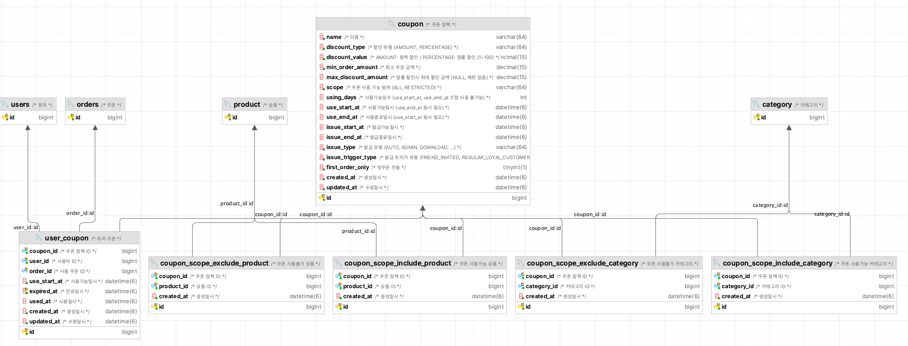

# Kmong Scenario

> AI 활용 내역(AI 제안과 내 판단 요약): [AI_USAGE.md](AI_USAGE.md)

## 쿠폰



```sql
-- 아래처럼 유저 주문 테이블 가정
CREATE TABLE `users`
(
    id BIGINT NOT NULL AUTO_INCREMENT PRIMARY KEY
) ENGINE = InnoDB
  DEFAULT CHARSET = utf8mb4
  COLLATE = utf8mb4_0900_ai_ci COMMENT = '유저';

CREATE TABLE `orders`
(
    id BIGINT NOT NULL AUTO_INCREMENT PRIMARY KEY
) ENGINE = InnoDB
  DEFAULT CHARSET = utf8mb4
  COLLATE = utf8mb4_0900_ai_ci COMMENT = '주문';

CREATE TABLE `category`
(
    id BIGINT NOT NULL AUTO_INCREMENT PRIMARY KEY
) ENGINE = InnoDB
  DEFAULT CHARSET = utf8mb4
  COLLATE = utf8mb4_0900_ai_ci COMMENT = '카테고리';

CREATE TABLE `product`
(
    id BIGINT NOT NULL AUTO_INCREMENT PRIMARY KEY
) ENGINE = InnoDB
  DEFAULT CHARSET = utf8mb4
  COLLATE = utf8mb4_0900_ai_ci COMMENT = '상품';

CREATE TABLE `coupon`
(
    id                  BIGINT         NOT NULL AUTO_INCREMENT PRIMARY KEY,
    name                VARCHAR(64)    NOT NULL COMMENT '이름',

    -- 할인 
    discount_type       VARCHAR(64)    NOT NULL COMMENT '할인 유형 (AMOUNT, PERCENTAGE)',
    discount_value      DECIMAL(15, 0) NOT NULL COMMENT 'AMOUNT: 정액 할인 / PERCENTAGE: 정률 할인 (1~100)',
    min_order_amount    DECIMAL(15, 0) NOT NULL DEFAULT 0 COMMENT '최소 주문 금액',
    max_discount_amount DECIMAL(15, 0) NULL COMMENT '정률 할인시 최대 할인 금액 (NULL, 제한 없음)',

    -- 사용/발급 
    scope               VARCHAR(64)    NOT NULL COMMENT '쿠폰 사용 가능 범위 (ALL, RESTRICTED)',
    using_days          INT            NULL COMMENT '사용가능일수 (use_start_at, use_end_at 조합 사용 불가능)',
    use_start_at        DATETIME(6)    NULL COMMENT '사용가능일시 (use_end_at 동시 필요)',
    use_end_at          DATETIME(6)    NULL COMMENT '사용종료일시 (use_start_at 동시 필요)',
    issue_start_at      DATETIME(6)    NULL COMMENT '발급가능일시',
    issue_end_at        DATETIME(6)    NULL COMMENT '발급종료일시',

    -- 화면에서 친구 쿠폰, 단골 회원
    issue_type          VARCHAR(64)    NOT NULL COMMENT '발급 유형 (AUTO, ADMIN, DOWNLOAD, ...)',
    issue_trigger_type  VARCHAR(64)    NOT NULL DEFAULT 'NONE' COMMENT '발급 트리거 유형 (FRIEND_INVITED, REGULAR_LOYAL_CUSTOMER, ...)',
    -- 화면에서 첫 거래 쿠폰
    first_order_only    BOOLEAN        NOT NULL DEFAULT 0 COMMENT '첫주문 전용',

    -- 감사
    created_at          DATETIME(6)    NOT NULL DEFAULT CURRENT_TIMESTAMP(6) COMMENT '생성일시',
    updated_at          DATETIME(6)    NOT NULL DEFAULT CURRENT_TIMESTAMP(6) ON UPDATE CURRENT_TIMESTAMP(6) COMMENT '수정일시',

    -- 할인유형별 범위 체크
    CONSTRAINT `chk_coupon_001` CHECK (
        (discount_type = 'AMOUNT' AND discount_value > 0)
            OR (discount_type = 'PERCENTAGE' AND 0 < discount_value AND discount_value <= 100)
        ),
    CONSTRAINT `chk_coupon_002` CHECK (min_order_amount >= 0),
    CONSTRAINT `chk_coupon_003` CHECK (max_discount_amount > 0),
    CONSTRAINT `chk_coupon_004` CHECK (using_days > 0),
    CONSTRAINT `chk_coupon_005` CHECK (use_start_at < use_end_at),
    CONSTRAINT `chk_coupon_006` CHECK (issue_start_at < issue_end_at),
    -- 사용기간 설정별 NULL 유무 체크
    CONSTRAINT `chk_coupon_007` CHECK (
        (using_days IS NOT NULL AND use_start_at IS NULL AND use_end_at IS NULL)
            OR (using_days IS NULL AND use_start_at IS NOT NULL AND use_end_at IS NOT NULL)
        )

) ENGINE = InnoDB
  DEFAULT CHARSET = utf8mb4
  COLLATE = utf8mb4_0900_ai_ci COMMENT = '쿠폰 정책';


CREATE TABLE `coupon_scope_include_category`
(
    id          BIGINT      NOT NULL AUTO_INCREMENT PRIMARY KEY,
    coupon_id   BIGINT      NOT NULL COMMENT '쿠폰 정책 ID',
    category_id BIGINT      NOT NULL COMMENT '카테고리 ID',
    created_at  DATETIME(6) NOT NULL DEFAULT CURRENT_TIMESTAMP(6) COMMENT '생성일시',

    UNIQUE KEY `unq_coupon_scope_include_category_001` (coupon_id, category_id),

    CONSTRAINT `frk_coupon_scope_include_category_001` FOREIGN KEY (coupon_id) REFERENCES coupon (id) ON DELETE RESTRICT,
    CONSTRAINT `frk_coupon_scope_include_category_002` FOREIGN KEY (category_id) REFERENCES category (id) ON DELETE RESTRICT

) ENGINE = InnoDB
  DEFAULT CHARSET = utf8mb4
  COLLATE = utf8mb4_0900_ai_ci COMMENT = '쿠폰 사용가능 카테고리';


CREATE TABLE `coupon_scope_exclude_category`
(
    id          BIGINT      NOT NULL AUTO_INCREMENT PRIMARY KEY,
    coupon_id   BIGINT      NOT NULL COMMENT '쿠폰 정책 ID',
    category_id BIGINT      NOT NULL COMMENT '카테고리 ID',
    created_at  DATETIME(6) NOT NULL DEFAULT CURRENT_TIMESTAMP(6) COMMENT '생성일시',

    UNIQUE KEY `unq_coupon_scope_exclude_category_001` (coupon_id, category_id),

    CONSTRAINT `frk_coupon_scope_exclude_category_001` FOREIGN KEY (coupon_id) REFERENCES coupon (id) ON DELETE RESTRICT,
    CONSTRAINT `frk_coupon_scope_exclude_category_002` FOREIGN KEY (category_id) REFERENCES category (id) ON DELETE RESTRICT

) ENGINE = InnoDB
  DEFAULT CHARSET = utf8mb4
  COLLATE = utf8mb4_0900_ai_ci COMMENT = '쿠폰 사용불가 카테고리';


CREATE TABLE `coupon_scope_include_product`
(
    id         BIGINT      NOT NULL AUTO_INCREMENT PRIMARY KEY,
    coupon_id  BIGINT      NOT NULL COMMENT '쿠폰 정책 ID',
    product_id BIGINT      NOT NULL COMMENT '상품 ID',
    created_at DATETIME(6) NOT NULL DEFAULT CURRENT_TIMESTAMP(6) COMMENT '생성일시',

    UNIQUE KEY `unq_coupon_scope_include_product_001` (coupon_id, product_id),

    CONSTRAINT `frk_coupon_scope_include_product_001` FOREIGN KEY (coupon_id) REFERENCES coupon (id) ON DELETE RESTRICT,
    CONSTRAINT `frk_coupon_scope_include_product_002` FOREIGN KEY (product_id) REFERENCES product (id) ON DELETE RESTRICT

) ENGINE = InnoDB
  DEFAULT CHARSET = utf8mb4
  COLLATE = utf8mb4_0900_ai_ci COMMENT = '쿠폰 사용가능 상품';


CREATE TABLE `coupon_scope_exclude_product`
(
    id         BIGINT      NOT NULL AUTO_INCREMENT PRIMARY KEY,
    coupon_id  BIGINT      NOT NULL COMMENT '쿠폰 정책 ID',
    product_id BIGINT      NOT NULL COMMENT '상품 ID',
    created_at DATETIME(6) NOT NULL DEFAULT CURRENT_TIMESTAMP(6) COMMENT '생성일시',

    UNIQUE KEY `unq_coupon_scope_exclude_product_001` (coupon_id, product_id),

    CONSTRAINT `frk_coupon_scope_exclude_product_001` FOREIGN KEY (coupon_id) REFERENCES coupon (id) ON DELETE RESTRICT,
    CONSTRAINT `frk_coupon_scope_exclude_product_002` FOREIGN KEY (product_id) REFERENCES product (id) ON DELETE RESTRICT

) ENGINE = InnoDB
  DEFAULT CHARSET = utf8mb4
  COLLATE = utf8mb4_0900_ai_ci COMMENT = '쿠폰 사용불가 상품';


CREATE TABLE `user_coupon`
(
    id           BIGINT      NOT NULL AUTO_INCREMENT PRIMARY KEY,
    coupon_id    BIGINT      NOT NULL COMMENT '쿠폰 정책 ID',
    user_id      BIGINT      NOT NULL COMMENT '사용자 ID',
    order_id     BIGINT      NULL COMMENT '사용 주문 ID',

    use_start_at DATETIME(6) NOT NULL COMMENT '사용가능일시',
    expired_at   DATETIME(6) NOT NULL COMMENT '만료일시',
    used_at      DATETIME(6) NULL COMMENT '사용일시',

    created_at   DATETIME(6) NOT NULL DEFAULT CURRENT_TIMESTAMP(6) COMMENT '생성일시',
    updated_at   DATETIME(6) NOT NULL DEFAULT CURRENT_TIMESTAMP(6) ON UPDATE CURRENT_TIMESTAMP(6) COMMENT '수정일시',

    CONSTRAINT `frk_user_coupon_001` FOREIGN KEY (coupon_id) REFERENCES coupon (id) ON DELETE RESTRICT,
    CONSTRAINT `frk_user_coupon_002` FOREIGN KEY (user_id) REFERENCES users (id) ON DELETE RESTRICT,
    CONSTRAINT `frk_user_coupon_003` FOREIGN KEY (order_id) REFERENCES orders (id) ON DELETE RESTRICT,

    INDEX `idx_user_coupon_001` (user_id, expired_at)

) ENGINE = InnoDB
  DEFAULT CHARSET = utf8mb4
  COLLATE = utf8mb4_0900_ai_ci COMMENT = '유저 쿠폰';
```

## 쿠폰 관련

### 쿠폰 사용 가능 범위 매핑 테이블

#### 매핑 테이블을 한개로 관리?

`target_type`(상품/카테고리), `target_id` (상품 ID/카테고리 ID), `include_type` (포함/제외) 컬럼을 추가하는 방향이면 N개로 분할하지 않고 한개로 가능하다.

이 부분은 장점일수도 단점일수도 있다.  
MD팀에서 상품에만 특정 기간동안만 적용되도록 요청이 온다고 하면 `start_at`, `end_at` 컬럼 추가와 쿼리, 코드를 수정을 하면 되고 카테고리도 해당 기능을 쉽게 사용 가능해진다.  
하지만 카테고리 row들은 필요 없는 컬럼과 데이터를 코드와 쿼리에서 조회가 되고 들고 있게 된다.

- 예를 들어 브랜드도 `target_type`에 추가 해달라는 요청이 온다면 테이블 추가 없이 코드로만 쉽게 수정이 가능하다.
- `target_id`는 FK로 관리가 불가능하고 코드나 데이터, comment 등을 보지 않는다면 테이블 구조가 어떻게 되어 있는지 모를수 있다.

#### 매핑 테이블을 N개로 관리?

- FK로 관리가 가능하며 1개로 했을때와 비교하여 테이블 구조나 코드에서 모호함이 없어지고 분명해진다.
- 테이블이 여러개로 되고 단순 코드 길이나 클래스 개수 등이 많아진다.
- 브랜드가 추가되면 포함/제외 테이블 2개 추가가 필요하다.

팀이나 개인 취향일 수도 있지만, 불편해도 명확하고 분명한 것은 대체 불가능한 장점이라고 생각하고 있고 분리하여 진행. (KISS, YAGNI)

### 1인 1쿠폰? 1인 N쿠폰?

만약 1인 1쿠폰이 정책이라면 `UNIQUE KEY (coupon_id, user_id)` 1인 1쿠폰을 쉽게 보장 하는 방법이 있다.  
분산락 등을 이용하여 쿠폰-유저 단위로 동시 처리 되지 않도록 추가 구성할 수도 있다.

1인 N쿠폰이라면 쿠폰 테이블에 `max_issue_per_user` 1인당 최대 발급 수량 컬럼을 두어 발급시 사용한다. 기본 값을 1로하면 1인 1쿠폰과 동일하다.  
위 유니크 키처럼 발급순번을 추가하여 `UNIQUE KEY (coupon_id, user_id, issue_seq)` 으로 DB단에서 보장할 수도 있다.  
이 경우도 분산락 이용하여 동시성 처리 구성할 수도 있다.

동시성 처리 방법은 여러가지 있는데 요청사항과 예상 요청 규모, 기능 특징, 현재 인프라 구성 등을 고려해서 적절한 방법을 선택하면 된다.

### 선착순 쿠폰?

마케팅 팀에서 선착순 쿠폰으로 최대 N개 발급가능한 쿠폰을 만들고 싶다고 요청이 온다고 가정,  
`max_issue_count`(운영자가 설정할 최대발급수량), `issued_count`(현재 발급수량) 컬럼을 추가하여 발급을 제한하도록 한다.  
(`issued_count` 컬럼은 실시간 변경이 가능한 값이니 캐싱에 주의가 필요하다)

여기서도 앞에서 처럼 동시성 처리가 필요해지는데 선착순 쿠폰 특성상 오픈 시점에 쏠릴수 있기 때문에 위 경우에서 분산락 구성과 다르게 쿠폰 단위로 동작이 필요해져서 분산락 구성시 병목 생길수 있다.

간단한 방법으로는 `아토믹 업데이트`로 아래처럼 업데이트문 실행하여 affected row 체크하는 방법이 있다.  
(최근 읽은 데이터 중심 어플리케이션 책에서 아토믹 업데이트로 해결 가능하다면 이게 최선이라는 절이 있었고 동의한다.)

```sql
UPDATE coupon
SET issued_count = issued_count + 1
WHERE id = {coupon_id}
  AND max_issue_count > issued_count;
```

다만, 예상 요청 규모가 큰 경우 아토믹 업데이트 경우 락 대기로 디비 커넥션 풀과 톰캣(mvc 경우) 대기 등의 병목이 생길수 있다.   
이미 인프라 구성이 어느정도 되어 있으면 선착순 쿠폰 발급 요청 단계에서 디비 커넥션을 전부 제거하고 레디스 루아 스크립트 사용(원자성 위해)하여 발급 가능 여부를 체크하고 발급 가능하다면 카프카 등 Pub-Sub으로 발급 구성하는 방법도 있다.

(예상 요청 규모가 큰 곳이 이미 구성이 안되어 있을리 없겠지만) 인프라 구성이 안 되어있다면 마케팅 팀하고 이야기를 하여 선착순 쿠폰 말고 다른 방식으로 진행하자는 등의 얘기나 현재 인프라에서 최선이 어떻게 될지? 수용가능한지? 고민이 필요하다.

### 데이터 수정 관련

이미 발급중인 쿠폰 수정을 하는 경우 소비자 관련 문제가 될 수 있기 때문에 정책상 수정 불가능 해야 하는데 `status` 상태 컬럼을 두어 드래프트는 수정 가능하도록 열어준다.

- `DRAFT`에서는 모든 필드가 수정 가능하고 `ACTIVE`에서는 특정 필드만 수정 가능하도록 할 수도 있다.
    - 예를 들어 ACTIVE에서는 할인 금액 관련 필드는 수정이 불가해야 한다.
    - 단순 이름 등은 수정되어도 좋다.

데이터 변경 기능 추가시 이력 관리가 필요해지는데 감사에서 의미 있는 이미 알려진 컬럼들을 추가한다.  
(이력 저장은 `spring data envers` 같은 감사 라이브러리 이용하거나 간단하게 직접 구현할 수도 있다)

- created_by, updated_by, deleted_by, deleted_at

### 최소주문금액, 정률할인 기준?

최소주문금액이나 정률할인을 계산할 기준금액이 필요하다. 커머스를 예로 들면

- 상품: 10,000원
- 배송비: 3,500원
- 적립금 사용: 1,000원
- 최종 결제 금액: 12,500원

최종 결제금액인 12,500원이 기준?  
상품만 포함하여 10,000원이 기준?  
적립금만 제외하여 13,500원이 기준?

어떻게 기준을 잡냐에 따라 쿠폰을 사용할수 있을지 없을지와 할인 금액이 달라지게 된다.  
또, 정률할인 특성상 소수점 금액이 발생할 가능성이 있는데 절사 정책 확인이 필요하다. 
(이 부분은 정산과도 관련이 되니 재무, 정산 담당자 등과도 얘기가 되어야 한다.)

크몽 경우 구매시 주문금액 + 수수료 = 총 결제 금액 구조로 10% 할인 쿠폰이 있고 10,000원 구매 가정.

- **쿠폰 미사용시**
    - 구매: 10,000원
    - 수수료: 4,500원
    - 총 결제금액: 14,500원
- **구매금액에만 할인 적용 (현재 이 방법 확인)**
    - 구매: 10,000원 - 1,000원 (쿠폰) = 9,000원
    - 수수료: 4,050원
    - 총 결제금액: 13,050원
- **구매금액 + 수수료 모두 할인 적용**
    - 구매: 10,000원
    - 수수료: 4,500원
    - 총 결제금액: 14,500원 - 1,450원 (쿠폰) = 13,050원

커머스에 배송비 같은 고정 금액이 없고 수수료만 비율로 추가되기 때문에 고객 입장에서는 결제금액은 이나저나 동일하다.
다만 서로 할인 금액이 다르게 계산되니 정산에서 어떤 값을 사용할지 정책 설정이 필요하다.

---

## 금액

요구사항에 맞춰서 코드 구현과 검증을 위한 테스트 코드 작성.

- 정책은 백오피스에서 생성/수정 등이 논리적으로 문제 없다고 가정하고 ProfitPolicy 객체에서 검증 단계는 생략.
- 절사는 따로 보이지 않아서 원 단위 미만 절사로 임의로 진행.

### 계산기를 Default, First, Second로 나눈 이유

처음 개발했을 때의 코드와 이후 추가 요구사항을 받았을 때 코드가 어떻게 변경되는지를 단계별로 보여주기 위해 
Calculator, ProfitPolicy, Repository를 나누어 진행.

- `DefaultProfitCalculator`: 처음 요구사항만으로 개발
- `FirstScenarioProfitCalculator`: 첫번째 추가 요구사항, 수수료 변경 반영
- `SecondScenarioProfitCalculator`: 두번째 추가 요구사항, 특정 카테고리 고정 수수료 반영

계산기는 주입 받은 정책으로 계산만 하기 때문에 추가 요구사항이 와도 계산기 코드는 변경이 없고, ProfitPolicy와 Repository 조회 조건만 변경된다.

### 첫번째 추가 요구사항

첫번째 수수료 변경 경우 paymentAmount 를 데이터베이스에 가지고 있으니 변경된 수수료 정책으로 재계산시 변경된 금액으로 계산 된다.

"지난달 거래를 다시 계산해야 합니다."를 거래 시점에 정산을 계산하는게 아니라 작업 완료 시점으로 가정하고 진행.

예를 들어 10월에는 수수료가 20%였고 10월 중 거래가 되었지만
11월 1일부터 수수료가 18%로 변경되었고 작업은 아직 미완료로 정산되지 않았다.

따라서 거래 시점의 정책 정보를 거래관련 db row에 스냅샷으로 가지고 있을 필요 까지는 없으며
작업 완료로 정산 시점에 db row에 정책 정보를 스냅샷으로 저장하고 계산 진행.

수수료 정책에 적용 기간(`startAt`, `endAt`)이 있다고 가정하고 repository에서 현재 시점에 적용 가능한 정책만 조회하도록 진행.

### 두번째 추가 요구사항

repository 시점에서 수수료 정책과 카테고리가 연결되어 있다고 가정하고 진행

- 정책 테이블과 카테고리 테이블 관계가 되어 있다고 가정하여 조회된 정책을 계산기에 의존성 주입하여 계산하도록
- 카테고리 전용 정책이 있다면 카테고리 정책으로, 없다면 기본 정책으로 계산하도록
- 고정 수수료는 구간이 한개(0원 ~ 상한 없음)인 정책으로 등록하면 계산기 코드 수정 없이 가능하다.

